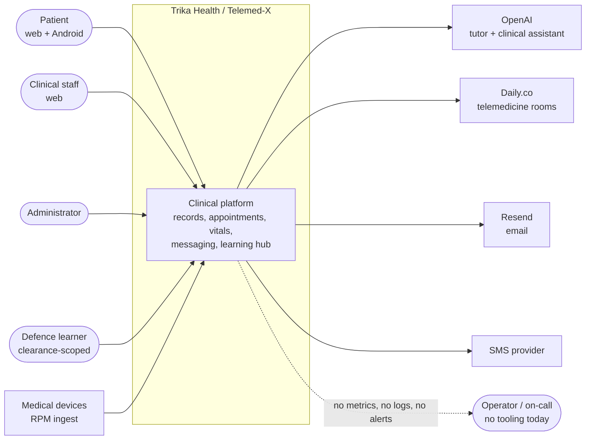
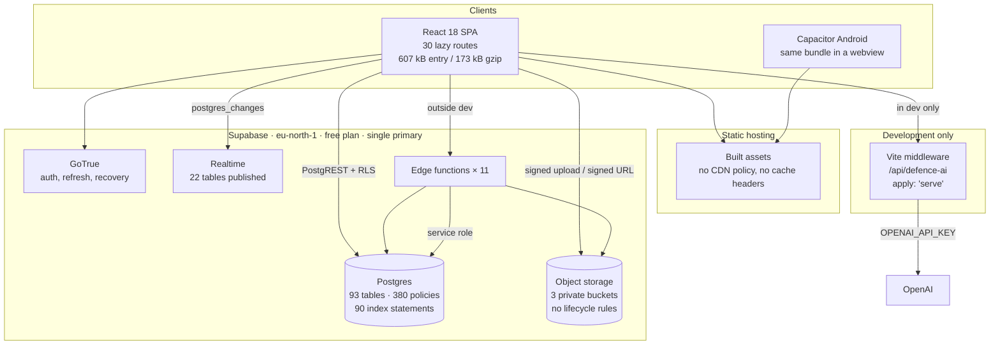
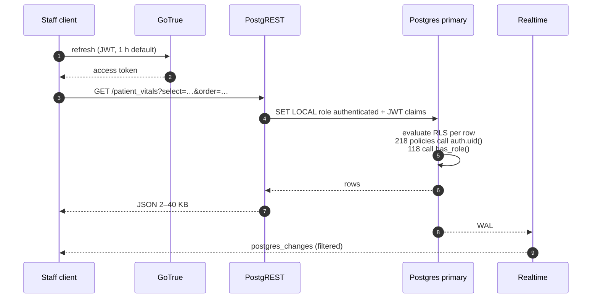
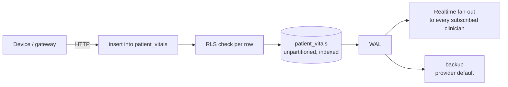
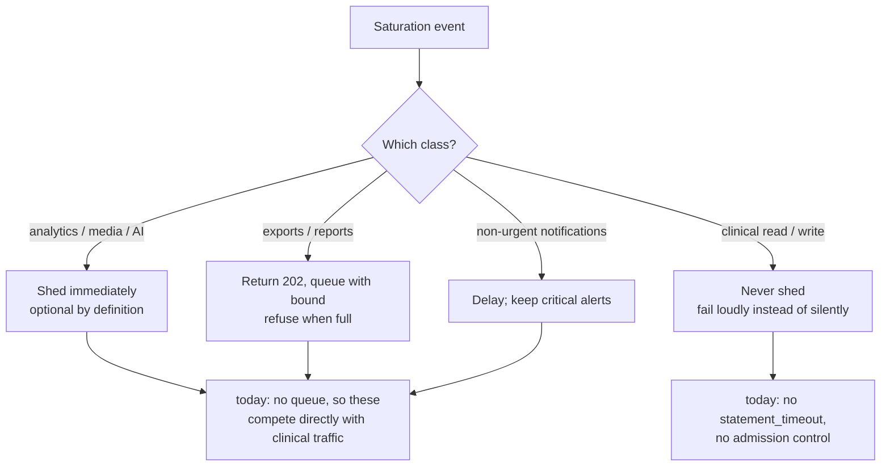
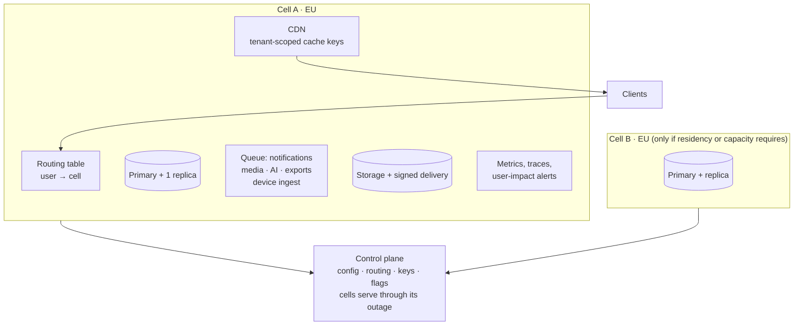

# Architecture — current state and target

**Status:** current state is observed from the repository at `2026-11-02`. Target state is proposed and not built.
**Companion:** `SCALABILITY_AUDIT.md` §12.3–§12.7 (limits, cells, residency), `docs/adr/` (decision records).

Everything below separates what exists from what is proposed. No diagram in this file implies a capability that has been measured.

---

## 1. System context

Users, external providers, and the boundary of the platform. Nothing inside the boundary has been load-tested.

The operator edge is dashed on purpose: there is no observability backend, so incidents are invisible until a user reports them (`SCALABILITY_AUDIT.md` §12.11).

---

## 2. Containers (as deployed today)

Two facts in this diagram are load-bearing:

- `middleware` and `fn` are **alternative** paths for the AI feature. The dev path exists only under `vite dev`; the edge function is written but **not deployed** (`SCALABILITY_AUDIT.md` §12.13 finding 5).
- Every data path terminates in one Postgres primary. There is no replica, no queue, and no second store.

---

## 3. Clinical read path (the dominant load)

85% of modelled requests are reads (§12.1.2). The path is client → PostgREST → RLS evaluation → table.

Failure and cost characteristics:

| Step | What breaks first | Mitigation in place |
|---|---|---|
| RLS per row | 5k-row scans per request at 380 policies | six policies rewritten in `20260331174041`, not extended |
| Result size | 55–65 unbounded list reads in the client | cursor helper (`src/lib/pagination.ts`) on the high-volume paths |
| Realtime | unfiltered subscriptions fan out to every client | staff messages now scoped to membership (§12.13 finding 4) |

---

## 4. Device ingest path (the hardest number)

2M monitored patients at one reading every 5 minutes is 576M writes/day, 26,700/s at peak. The path today:

There is no admission control, no batching, no dead-letter path, and no idempotency key. A retried device write creates a duplicate reading. This is the path the capacity plan is built around, and the one that must be restructured before any ingest client is shipped at scale (§12.3 limit 1, §12.6).

---

## 5. Failure and degradation ladder

The intended order of shedding, from the SLO matrix. Only the left column is implemented (by omission — nothing is shed today because nothing is bounded).

The gap this diagram exposes: without queues and timeouts there is no mechanism to honour the ladder. Overload produces uniform degradation, including of clinical work, rather than an ordered shed.

---

## 6. Target state (proposed, gated on measurement)

Introduce components only when a measurement demands them. Each box below has a trigger in §12.12.3.

**Not justified yet.** One region may well meet the agreed SLOs at the modelled load; the cost of a second cell is a second database cluster, a second pipeline, and a control plane with its own failure modes (§12.7.3). Cells are included here as a shape to plan around, not a commitment.

---

## 7. Diagram inventory and provenance

| Diagram | Source | Confidence |
|---|---|---|
| Context | provider calls in edge functions and `src/lib` | observed |
| Containers | `supabase/`, `vite.config.ts`, build output | observed |
| Read path | `src/hooks`, RLS migrations | observed, RLS cost modelled |
| Ingest path | `20260221145003_*.sql`, `20260222101104_*.sql` | observed |
| Degradation | SLO matrix §12.2 | proposed |
| Target cells | §12.7.3 | proposed |

Counts (93 tables, 380 policies, 90 index statements, 22 realtime tables) are from the 2026-11-01 audit of 48 applied migrations plus the 4 on disk. Re-derive after the pending migrations are applied.
